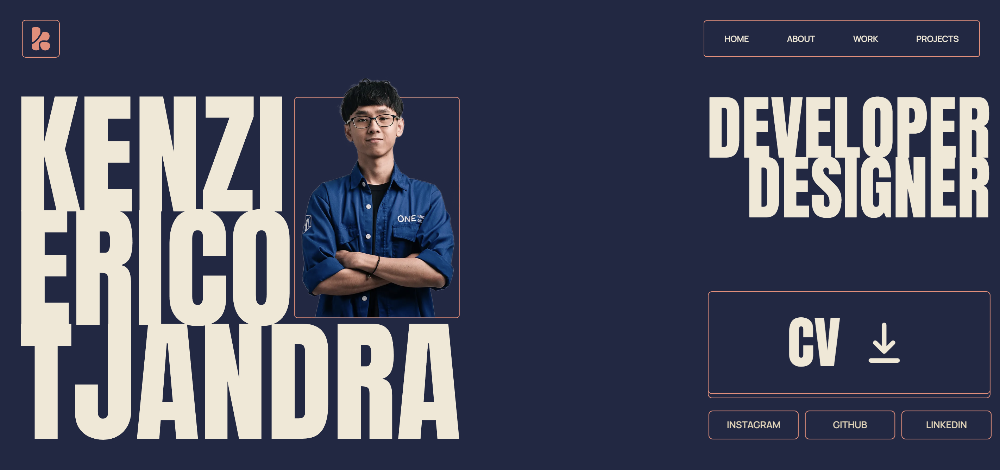

# Kenfolio

My personal portfolio website, showcasing my projects, work experience, publication and skills as a developer and designer.

**Live site:** [itskenz.vercel.app](https://itskenz.vercel.app)



## About

Kenfolio is a single-page portfolio built with Next.js, designed to feel cinematic and interactive:

- **Rubik's cube loader** that solves itself with a Jb perm while the site loads
- **Scroll-driven transitions** between sections, powered by GSAP ScrollTrigger and Lenis smooth scrolling
- **Horizontal experience track** with sticky category titles
- **Skill tooltips** showing what I've built with each technology and which projects use it
- **Responsive layouts** for desktop and mobile, with a hero that scales to the screen size

## Tech Stack

| Area | Tools |
| --- | --- |
| Framework | [Next.js](https://nextjs.org/) (App Router), [React](https://react.dev/), TypeScript |
| Styling | [Tailwind CSS](https://tailwindcss.com/) |
| Animation | [GSAP](https://gsap.com/) + ScrollTrigger, [Framer Motion](https://motion.dev/), [Lenis](https://github.com/darkroomengineering/lenis) |
| 3D | [Three.js](https://threejs.org/) via [React Three Fiber](https://r3f.docs.pmnd.rs/) |
| Hosting | [Vercel](https://vercel.com/) |

## Project Structure

```
src/
├── app/
│   ├── layout.tsx            # Fonts, metadata, Lenis provider
│   ├── page.tsx              # Page composition and loader → site transition
│   ├── globals.css           # Global styles and theme
│   └── providers/            # Lenis smooth-scroll setup
├── components/
│   ├── three/                # Rubik's cube loader (React Three Fiber)
│   ├── Hero.tsx, HeroAboutTransition.tsx, AboutContent.tsx
│   ├── ExperienceIntro.tsx, ExperienceShowcase.tsx
│   ├── Publication.tsx, Skills.tsx, SkillPopover.tsx
│   ├── ProjectShowcase.tsx, Footer.tsx, Navbar.tsx
│   └── ...
├── data/                     # All site content lives here
│   ├── experience.ts         # Work, organizational and competition entries
│   ├── projects.ts           # Project cards
│   └── skills.ts             # Skill descriptions shown in tooltips
└── lib/                      # Small shared helpers
public/                       # Images, icons and resume
```

Content and design are kept separate: to add a project, experience or skill, edit the files in `src/data/` and the page updates automatically.

## Running Locally

### Prerequisites

- [Node.js](https://nodejs.org/) 20.9 or newer
- npm (comes with Node.js)

### Setup

1. **Clone the repository**

   ```bash
   git clone https://github.com/kenzitjandra/kenfolio.git
   cd kenfolio
   ```

2. **Install dependencies**

   ```bash
   npm install
   ```

3. **Start the development server**

   ```bash
   npm run dev
   ```

4. Open [http://localhost:3000](http://localhost:3000) in your browser.

### Available Scripts

| Command | Description |
| --- | --- |
| `npm run dev` | Start the development server with hot reload |
| `npm run build` | Create a production build |
| `npm run start` | Run the production build locally (after `npm run build`) |
| `npm run lint` | Check the code with ESLint |

## Contact

- **Email:** [kenzitjandra@gmail.com](mailto:kenzitjandra@gmail.com)
- **LinkedIn:** [Kenzi Erico Tjandra](https://www.linkedin.com/in/kenzi-erico-tjandra-b65a2728a/)
- **GitHub:** [@kenzitjandra](https://github.com/kenzitjandra)
- **Instagram:** [@kenzitjandra](https://www.instagram.com/kenzitjandra/)

---

The code is available for reference and learning. Please don't reuse my personal content (photos, resume, written descriptions) or present this site as your own.
